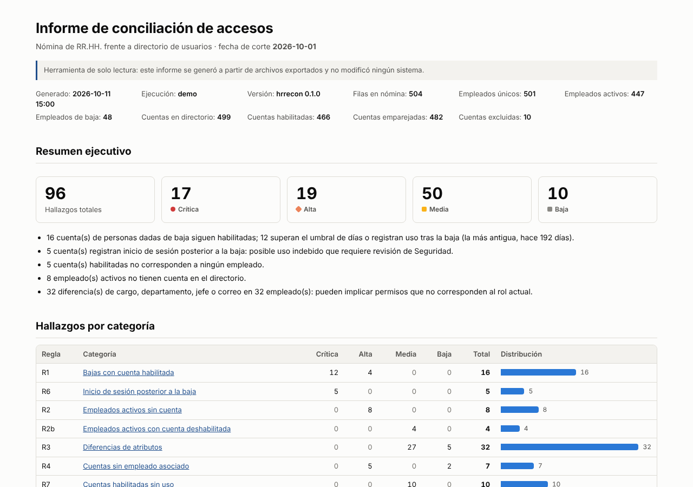
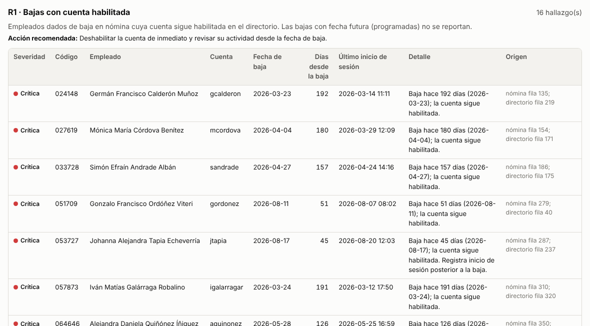
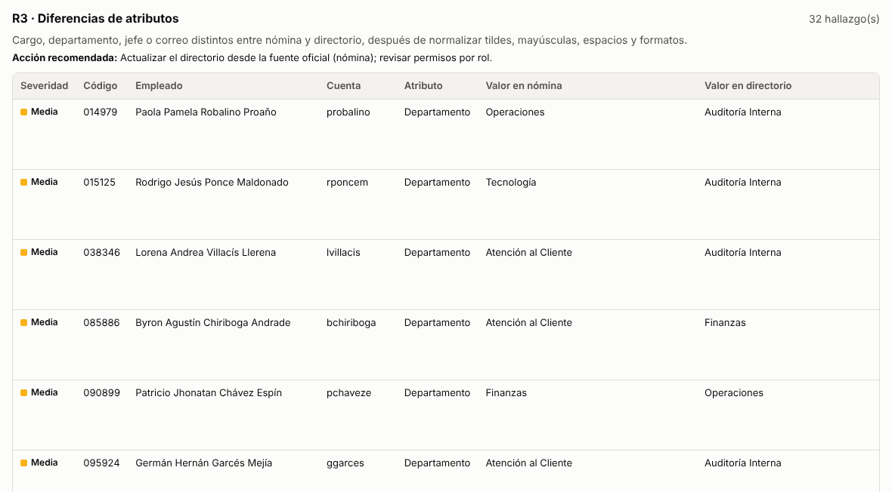
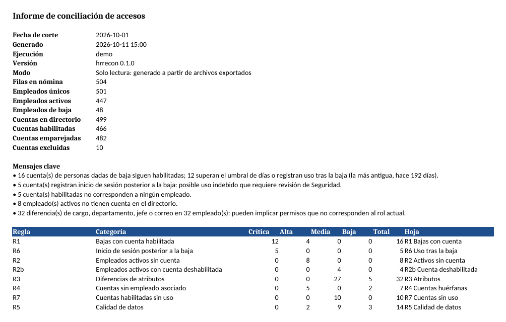
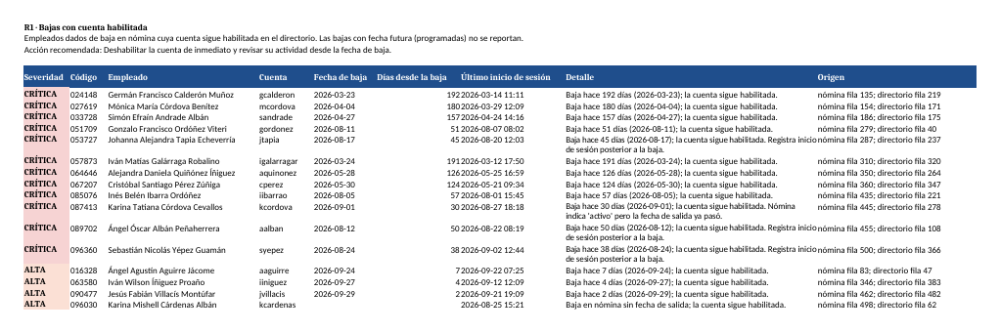

# hr-directory-reconciler

**[Español](#español) · [English](#english)**



---

## Español

Herramienta de **solo lectura** que concilia una exportación de **nómina de RR.HH.** con
una exportación de **usuarios de un directorio** (tipo Active Directory). Detecta riesgos de
acceso: personas dadas de baja con la cuenta todavía habilitada, empleados activos sin cuenta,
cambios de cargo, departamento o jefe que no se reflejaron, cuentas huérfanas, cuentas sin uso
y problemas de calidad de datos. Genera un **reporte HTML** legible para gerencia, un **Excel**
con una hoja por categoría y **evidencia de auditoría** (SHA-256 en un registro encadenado).

> **Solo lectura.** La herramienta solo lee archivos CSV/Excel locales y escribe reportes.
> No se conecta a ningún directorio, base de datos ni red, y no modifica ningún sistema. Una
> prueba automática (`tests/test_readonly.py`) verifica que el paquete no importa módulos de
> red ni de LDAP, y otra que los archivos de entrada no cambian.
>
> **Datos ficticios.** Todos los datos del repositorio son inventados: la empresa
> "Comercial Andina" no existe, el dominio es `.example` (reservado) y los nombres se combinan
> al azar.

### Instalación

Requiere Python 3.11 o superior.

```bash
git clone https://github.com/AlvaroFCV/hr-directory-reconciler.git
cd hr-directory-reconciler
python -m venv .venv && source .venv/bin/activate   # Windows: .venv\Scripts\activate
pip install -e ".[dev]"
```

### Uso rápido

```bash
# 1. (Opcional) Regenerar los datos ficticios de ejemplo
hrrecon generate --out data/sample --employees 500 --seed 42 --as-of 2026-10-01

# 2. Conciliar y generar los reportes (HTML + Excel + evidencia)
hrrecon reconcile --config config/config.example.yaml --as-of 2026-10-01

# 3. Verificar que un reporte no fue modificado
hrrecon verify output/reporte_conciliacion_*.html --log output/evidence_log.jsonl
```

Salida de `reconcile` con los datos de ejemplo:

```text
Conciliación (solo lectura) · fecha de corte 2026-10-01 · ejecución 20261011_145923

  Regla Categoría                                    Total
  R1    Bajas con cuenta habilitada                     16
  R6    Inicio de sesión posterior a la baja             5
  R2    Empleados activos sin cuenta                     8
  R2b   Empleados activos con cuenta deshabilitada       4
  R3    Diferencias de atributos                        32
  R4    Cuentas sin empleado asociado                    7
  R7    Cuentas habilitadas sin uso                     10
  R5    Calidad de datos                                14

  Crítica: 17 · Alta: 19 · Media: 50 · Baja: 10

Reporte HTML:  output/reporte_conciliacion_20261011_145923.html
Reporte Excel: output/reporte_conciliacion_20261011_145923.xlsx
Evidencia:     output/evidence_log.jsonl
Cabeza del registro (guárdela aparte para detectar truncamiento): 584e772c6f3d5c04…
```

| Comando | Descripción |
|---|---|
| `hrrecon generate [--out] [--employees] [--seed] [--as-of]` | Genera `nomina.xlsx`, `directorio.csv` y `expected_traps.json` con datos ficticios. |
| `hrrecon reconcile -c CONFIG [--hr] [--directory] [--out] [--log] [--as-of] [--fail-on SEV]` | Concilia, escribe los reportes y registra la evidencia. `--fail-on critica` devuelve código 2 si hay hallazgos de esa severidad o mayor (útil en CI). |
| `hrrecon verify [REPORTES…] --log LOG [--head HASH]` | Comprueba la cadena del registro y el hash de cada reporte. Devuelve 0 si todo está íntegro y 1 si no. |

`--as-of` fija la fecha de corte. Sin ella se usa la fecha de hoy, así que con los datos de
ejemplo los días transcurridos cambian según cuándo se ejecute.

### Configuración (YAML)

El formato de cada exportación se describe en un archivo YAML; no hace falta tocar el código
para adaptarse a otro sistema. Las rutas relativas se resuelven respecto a la carpeta del YAML.
Ejemplo completo y comentado: [`config/config.example.yaml`](config/config.example.yaml).

```yaml
hr:
  file: ../data/sample/nomina.xlsx
  sheet: Empleados
  columns:                     # campo_canónico: "Encabezado en la exportación"
    employee_id: "Código Empleado"   # obligatorio
    status: "Estado"                 # obligatorio
    first_name: "Nombres"
    last_name: "Apellidos"
    title: "Cargo"
    department: "Departamento"
    manager_id: "Código Jefe"
    email: "Correo Corporativo"
    hire_date: "Fecha Ingreso"
    termination_date: "Fecha Salida"
  status_values:
    active: ["activo", "vigente"]
    terminated: ["baja", "inactivo", "cesante"]

directory:
  file: ../data/sample/directorio.csv
  delimiter: ";"
  columns:
    account: "sAMAccountName"        # obligatorio
    enabled: "Enabled"               # obligatorio
    employee_id: "employeeID"
    manager: "Manager"               # DN (CN=…,OU=…), cuenta o código de empleado
    last_logon: "LastLogonDate"      # opcional: sin ella, R6 y R7 se omiten sin error
    # display_name, title, department, email…
  enabled_values: ["true", "1", "habilitado"]

matching:
  keys: [employee_id, email]         # primero por código; si no hay, por correo
  id_format: { zfill: 6 }            # '4512', '004512' y '4512.0' son el mismo código

exclusions:
  service_accounts:
    account_patterns: ["^svc[_-]", "^sa_", "^admin\\."]
    accounts: ["scanner.piso3"]
  accounts: ["recepcion.general"]               # cuentas especiales: fuera de todas las reglas
  employee_ids: []                              # empleados fuera de todas las reglas
  titles_no_account_required: ["Pasante"]       # solo se omiten de R2/R2b

rules:
  as_of: null                        # fecha de corte; null = hoy
  termination_escalation_days: 7     # R1: más días desde la baja => CRÍTICA
  stale_account_days: 90             # R7: días sin inicio de sesión
```

Los encabezados se comparan sin distinguir mayúsculas ni espacios extremos (`"Cargo "` coincide
con `"Cargo"`). Si falta una columna obligatoria, el error indica cuáles sí existen en el archivo.

### Normalización

Antes de comparar, los valores se normalizan. En el reporte siempre aparece el valor original.

| Tipo | Ejemplos que se consideran iguales |
|---|---|
| Texto (cargo, departamento) | `Gestión Humana` = `GESTION HUMANA` = `  gestion   humana ` |
| Códigos de empleado | `4512` = `004512` = ` 4512 ` = `4512.0` (número convertido por Excel) |
| Correo | `Ana.Munoz@X.example` = `ana.munoz@x.example` |
| Cuenta | `ANDINA\AMunoz` = `amunoz` |
| Fechas | `05/03/2026` (día primero), `2026-03-05`, celdas de fecha de Excel |
| Jefe | `CN=Ana Muñoz,OU=TI,DC=…` → `Ana Muñoz` (respeta comas escapadas `\,`) |

### Reglas

| Regla | Detecta | Severidad |
|---|---|---|
| **R1** Bajas con cuenta habilitada | Empleado de baja con alguna cuenta habilitada. Muestra los días desde la baja. Las bajas con **fecha futura** (programadas) no se reportan y quedan listadas como exclusión. | ALTA; **CRÍTICA** si supera `termination_escalation_days` o hubo inicio de sesión tras la baja |
| **R6** Inicio de sesión posterior a la baja | Cualquier cuenta, habilitada o no, cuyo último inicio de sesión es posterior a la fecha de baja. Requiere `last_logon`. | CRÍTICA |
| **R2** Activos sin cuenta | Empleado activo sin cuenta (ni por código ni por correo). Omite altas con fecha futura y cargos configurados sin cuenta obligatoria (pasantes). | ALTA |
| **R2b** Activos con cuenta deshabilitada | Empleado activo cuyas cuentas están todas deshabilitadas. | MEDIA |
| **R3** Diferencias de atributos | Cargo, departamento, jefe o correo distintos tras normalizar. El jefe se resuelve aunque venga como DN, cuenta o código. | MEDIA; BAJA si un lado está vacío |
| **R4** Cuentas sin empleado | Cuentas que no corresponden a ningún empleado, sin contar las de servicio ni las especiales. | ALTA si está habilitada; BAJA si no |
| **R7** Cuentas sin uso | Cuentas habilitadas sin inicio de sesión en `stale_account_days` días. Omite altas recientes y bajas, que ya cubre R1. Requiere `last_logon`. | MEDIA |
| **R5** Calidad de datos | Códigos duplicados en nómina (se concilia con la fila vigente), filas sin código, estados no reconocidos, bajas sin fecha, estado "activo" con fecha de salida pasada, varias cuentas habilitadas para un empleado, correos duplicados (nómina y directorio) y cuentas emparejadas solo por correo. | ALTA / MEDIA / BAJA |

Si la columna `last_logon` no existe, R6 y R7 aparecen como "omitidas" en los reportes, sin error.
Todas las exclusiones aplicadas se listan en el reporte para que quede rastro auditable.

### Datos de ejemplo y casos trampa

`hrrecon generate` crea unas 500 personas con nombres ecuatorianos con tildes y ñ
(Peñaherrera, Íñiguez, Quiñónez…), una jerarquía de jefes coherente y, a propósito:

- bajas con cuenta activa (hace 2 a 200 días, una justo en el umbral de 7 días, una sin fecha
  y una con estado "Activo" pero fecha de salida pasada);
- inicios de sesión posteriores a la baja, en cuentas habilitadas y deshabilitadas;
- bajas programadas con fecha futura y altas futuras, que **no** deben reportarse;
- altas sin cuenta, cuentas deshabilitadas de empleados activos y pasantes sin cuenta;
- cambios de cargo, departamento, jefe y correo no reflejados, y campos vacíos;
- jefes en tres formatos: DN (`CN=…,OU=…`), cuenta y código de empleado;
- cuentas huérfanas, de servicio (`svc_backup`, `admin.ti`…) y especiales;
- códigos y correos duplicados, una fila sin código y un estado vacío;
- 60 empleados con "ruido" cosmético (mayúsculas, tildes, espacios dobles, IDs sin ceros o
  como número de Excel) que **no** deben generar hallazgos.

`data/sample/expected_traps.json` documenta exactamente qué debe detectar cada regla, y las
pruebas lo verifican elemento por elemento.

### Reportes

**HTML** (autocontenido, sin JavaScript ni recursos externos; se imprime bien como PDF y respeta
el modo oscuro del sistema): resumen ejecutivo, totales por severidad, tabla por categoría,
detalle por regla con la acción recomendada, exclusiones y hashes de los archivos de entrada.




**Excel**: hoja `Resumen`, una hoja por categoría (`R1 Bajas con cuenta`, `R3 Atributos`…),
`Excluidos` y `Entradas`, con filtros, encabezados fijos, severidad resaltada y formato de
impresión horizontal.




### Evidencia para auditoría

Cada ejecución agrega al registro `output/evidence_log.jsonl` una línea por archivo, con el
SHA-256 de los archivos de entrada y de ambos reportes:

```json
{"seq": 3, "timestamp": "2026-10-11T14:59:23+00:00", "run_id": "20261011_145923",
 "kind": "report", "role": "html", "file": "reporte_conciliacion_20261011_145923.html",
 "file_name": "reporte_conciliacion_20261011_145923.html",
 "sha256": "f2a913022d58822cc0926f9e23e3112c352185bfd5614531052a98c2d7e111d5",
 "size": 53090, "tool_version": "0.1.0",
 "prev_hash": "c2b3d93db5052bcfcb05323898306ddf117daba7d98909535f0e9689414941a7",
 "entry_hash": "48fe59313c19e028f3935d5b79e462c199d233587fdcf79a1d7de37626e4bb34"}
```

- **Registro encadenado**: cada línea incluye el `entry_hash` de la anterior (la primera usa
  64 ceros). Si se edita, borra, inserta o reordena una línea, la cadena se rompe y `verify` lo
  indica con el número de línea. Si el registro está dañado, `reconcile` se niega a agregar
  entradas.
- **Reportes alterados**: `verify` recalcula el hash del archivo y lo compara con la última
  entrada registrada para él. Busca primero por ruta y luego por nombre, para poder verificar
  copias entregadas a auditoría.
- **Truncamiento**: si alguien borra las *últimas* líneas, la cadena restante sigue siendo
  coherente. Por eso `reconcile` imprime la **cabeza** del registro: guárdela fuera del sistema
  (correo, ticket) y verifíquela con `hrrecon verify --head <hash>`.

```text
$ hrrecon verify output/reporte_conciliacion_20261011_145923.html --log output/evidence_log.jsonl
Registro de evidencia íntegro: 4 entradas encadenadas.
OK          output/reporte_conciliacion_20261011_145923.html  (sha256 f2a913022d58822c…, registrado 2026-10-11T14:59:23+00:00, ejecución 20261011_145923, por ruta)

# después de editar el reporte (código de salida 1):
MODIFICADO  output/reporte_conciliacion_20261011_145923.html  (actual b7824f31da181758…, registrado f2a913022d58822c…)
```

Nota: el registro detecta manipulación, pero no la impide. Quien controle el registro completo
podría reescribirlo entero; la cabeza guardada aparte cubre ese caso.

### Pruebas

```bash
pytest          # 80 pruebas: una o más por regla, con los casos trampa y con casos escritos a mano
ruff check .
```

Las pruebas cubren cada regla (R1–R7), la normalización, la configuración, el mapeo de columnas,
las exclusiones, los reportes, la evidencia (reporte alterado, línea editada, borrada,
reordenada o truncada), la CLI de punta a punta y la garantía de solo lectura.

Para regenerar las capturas: `pip install -e ".[screenshots]"` y
`python scripts/make_screenshots.py`. Usa Playwright para el HTML y, si está instalado,
LibreOffice para el Excel.

### Estructura

```
config/config.example.yaml   mapeo de columnas, exclusiones y umbrales
data/sample/                 datos ficticios + expected_traps.json
src/hrrecon/
  cli.py                     comandos generate | reconcile | verify
  config.py                  carga y validación del YAML
  loader.py                  lectura de CSV/Excel y mapeo de columnas
  normalize.py               tildes, mayúsculas, espacios, IDs, fechas, DN
  engine.py                  emparejamiento, exclusiones, resolución de jefes
  rules/                     una regla por módulo (R1–R7) + registro
  report/                    HTML (Jinja2) y Excel (openpyxl)
  evidence.py                SHA-256 y registro encadenado
  generator.py               datos ficticios con casos trampa
  runner.py                  orquesta una ejecución completa
tests/                       pytest
```

### Licencia

MIT. Ver [LICENSE](LICENSE).

---

## English

A **read-only** tool that reconciles an **HR payroll export** against a **directory user
export** (Active Directory style). It flags access risks such as terminated employees whose
accounts are still enabled, active employees with no account, title, department or manager
changes that were never applied, orphaned accounts, unused accounts and data-quality problems.
It produces a management-friendly **HTML report**, an **Excel workbook** with one sheet per
category, and **audit evidence** (SHA-256 hashes in a hash-chained log).

> **Read-only.** The tool only reads local CSV/Excel files and writes reports. It never
> connects to a directory, database or network, and never modifies any system. An automated
> test checks that the package imports no network or LDAP modules, and another checks that the
> input files are left unchanged.
>
> **Fictitious data.** All data in this repository is made up: the company, the `.example`
> domain and the randomly combined names.

### Installation

```bash
git clone https://github.com/AlvaroFCV/hr-directory-reconciler.git
cd hr-directory-reconciler
python -m venv .venv && source .venv/bin/activate
pip install -e ".[dev]"
```

### Quick start

```bash
hrrecon generate --out data/sample --employees 500 --seed 42 --as-of 2026-10-01   # optional
hrrecon reconcile --config config/config.example.yaml --as-of 2026-10-01
hrrecon verify output/reporte_conciliacion_*.html --log output/evidence_log.jsonl
```

- `reconcile` writes the HTML and Excel reports to `output/` and appends the hashes of the inputs
  and reports to the evidence log. `--fail-on critica|alta|media|baja` exits with code 2 when
  there are findings at or above that severity, which is useful in CI.
- `verify` checks the log's hash chain and each report's hash. It exits with 0 when everything
  is intact and 1 otherwise.
- `--as-of` sets the cut-off date. Without it, today's date is used.

### Configuration

Column mappings, status values, matching keys, ID format, exclusions and thresholds all live in a
YAML file, so you can adapt to another export format without changing code. See the annotated
[`config/config.example.yaml`](config/config.example.yaml). Relative paths are resolved against
the YAML file's folder. Only `employee_id` and `status` (HR) and `account` and `enabled`
(directory) are required. `last_logon` is optional: without it, R6 and R7 are skipped without
an error.

### Normalization

Comparisons ignore accents, case and extra whitespace. Employee IDs are normalized, so `4512`,
`004512`, ` 4512 ` and `4512.0` are the same ID. Emails are compared case-insensitively, and
`DOMAIN\user` prefixes are stripped. Dates are accepted as day-first strings, ISO strings or
Excel date cells. Managers given as a DN (`CN=…,OU=…`), an account name or an employee ID are
all resolved to the same person. Reports always show the original values.

### Rules

| Rule | Detects | Severity |
|---|---|---|
| **R1** Terminated with enabled account | Shows the days since termination. Terminations dated in the future are not reported. | HIGH; **CRITICAL** above `termination_escalation_days` or when there was a logon after termination |
| **R6** Logon after termination | Any account, enabled or not, with a last logon after the termination date (needs `last_logon`). | CRITICAL |
| **R2** Active without account | Skips future hires and titles configured as not requiring an account (interns). | HIGH |
| **R2b** Active with only disabled accounts | | MEDIUM |
| **R3** Attribute drift | Title, department, manager or email mismatch after normalization. | MEDIUM; LOW if one side is empty |
| **R4** Orphaned accounts | Accounts with no matching employee; service and special accounts are excluded. | HIGH if enabled, LOW if disabled |
| **R7** Unused accounts | Enabled accounts with no logon in `stale_account_days` days (needs `last_logon`). | MEDIUM |
| **R5** Data quality | Duplicate IDs (reconciled against the current row), missing IDs, unknown statuses, terminations without a date, status/date conflicts, several enabled accounts per employee, duplicate emails, and email-only matches. | HIGH / MEDIUM / LOW |

Every exclusion that was applied is listed in the reports, so there is an audit trail.

### Sample data and traps

`hrrecon generate` creates about 500 people with Ecuadorian names that include accents and ñ,
and deliberately injects every case above. It also adds 60 rows of purely cosmetic noise (case,
accents, double spaces, IDs without leading zeros) that must **not** be flagged.
`data/sample/expected_traps.json` lists exactly what each rule should find, and the tests assert
it item by item.

### Audit evidence

Each run appends one JSON line per file (inputs and reports) to `evidence_log.jsonl`, holding
the file's SHA-256, the previous line's `entry_hash` and its own `entry_hash`. `verify` detects:

- **modified reports**, because the hash no longer matches. Lookup is by path, then by file
  name, so copies handed to auditors can also be checked;
- **a tampered log**, meaning an edited, deleted, inserted or reordered line, because the chain
  breaks. `reconcile` refuses to append to a broken log;
- **a truncated log**, when you pass the head hash that `reconcile` prints to
  `verify --head`. Store that hash outside the system.

The chain makes tampering *detectable*, not impossible. Someone with full control could rewrite
the whole log, and the externally stored head hash covers that case.

### Tests

`pytest` runs 80 tests covering every rule (against both the generated traps and small
hand-written cases), normalization, configuration, reports, evidence tampering scenarios, the
CLI end to end, and the read-only guarantee. Lint with `ruff check .`.

### License

MIT. See [LICENSE](LICENSE).
